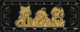
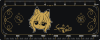

# 如何把自己喜欢的角色做成 PCB 周边

> **AI 生成说明**：本教程由 AI 生成。随附的 PCB 尺由 AI 辅助生成和整理，并依据用户提供的角色设定、原签名和修改意见调整。签名来自用户提供的参考图。

这篇教程用一把角色主题 PCB 尺举例。黑色阻焊做底色，沉金做人物和装饰，白色丝印勾出外轮廓和读数。做挂件、徽章或立牌时也能用同样的方法，只需要换板框和版面。

## 1. 先确定实物尺寸，再画线稿

先定成品尺寸和用途。尺子需要给刻度留出上下边距，挂件要给挂孔和板边留空间。用于这个例子的板框是 **100 × 40 mm**，四角圆角。正反两面的上沿是 **0–9 cm**，下沿是 **0–3500 mil**。公制小格是 **1 mm**，mil 小格是 **50 mil（1.27 mm）**，在 PCB 编辑器里按坐标定位刻度。

选有辨识度的五官、发型和服饰轮廓。先在黑底上用金、白两色试着填一版，缩到成品尺寸，看看眼睛、发梢和手指还能不能读清。细线要是挤在一团，可以保留最能认出角色的几根，把其余线简化。使用别人绘制的角色图、标识或签名时，先确认素材允许你打样以及按计划发布。

## 2. 把图案拆成板厂能做的层

| 看到的效果 | 需要放置的图形 |
| --- | --- |
| 黑色底面和人物内的黑线 | 让这些区域保留黑色阻焊 |
| 金色人物、边框和主要刻度 | 铜层放闭合图形，并在对应面阻焊层创建匹配的开窗。下单选沉金（ENIG） |
| 白色外描边、数字和次要刻度 | 放到对应面的丝印层 |
| 尺体、圆角和开槽 | 将外框放到单独的板框输出层，外轮廓保持闭合。有孔则另确认钻孔输出 |

**留空的黑线和镂空也要设计。** 比如想让沉金脸部上的睫毛显示为黑色，就在金色图形中留出对应的黑线。白描边应和沉金区域留有间隔。越细的金线、黑色阻焊间隔和白丝印越容易受制程影响，具体按选用的板色、层数和工艺核对板厂能力。嘉立创建议铜开窗与丝印间距至少 0.15 mm，可留得更宽一些。 [嘉立创 PCB 制造能力](https://jlcpcb.com/capabilities/pcb-capabilities)

## 3. 在 Altium 里放图并检查方向

1. 新建 PCB，切到毫米单位，定义板框。把排版稿拆成铜、阻焊开窗和丝印三套图形，用同一原点和尺寸对齐。
2. 在相应层放置图形。Altium Designer 21 及以上版本可以使用 PCB 编辑器的 **Place → Graphics** 导入图像。复杂图案可先把线稿转成带镂空的闭合矢量轮廓，再转换为 PCB 区域（Region）。导入后用已知长度核对比例，并放大确认眼睛等镂空仍在。此示例的正面通过原线稿的灰度边缘提取轮廓，减少斜线的像素台阶。 [Altium 图形导入说明](https://www.altium.com/documentation/knowledge-base/altium-designer/place-a-logo-graphic-into-a-pcb)
3. **用背面视图检查背面。** 在顶视坐标中，底层图案和文字通常看起来反向。翻到背面后，确认签名和刻度都能正常阅读，并且开窗仍与铜层对齐。

## 4. 导出制板文件，按实物尺寸审图

从 **File → Fabrication Outputs** 导出 Gerber 或 Gerber X2，包含顶底铜、顶底阻焊、顶底丝印和板框。设计里有钻孔时再导出 NC Drill，并与 Gerber 使用一致的原点和单位。用 Gerber 查看器分别开关各层，检查圆角、镂空和开窗，再切换到背面确认方向。 [Altium 制造文件导出说明](https://www.altium.com/documentation/altium-designer/preparing-for-manufacture/output-jobs/fabrication-data)

本例规格为双层 FR-4、板厚 1.6 mm、黑色阻焊、白色丝印、沉金，无钻孔。上传 ZIP 后按这些规格核对订单，并查看板厂处理后的生产文件。重点比较细发丝、笔画间隙和白描边。先打少量样板，看实物的对比和反光，再决定是否放大细节或追加数量。 [嘉立创生产文件确认说明](https://jlcpcb.com/help/article/how-to-confirm-the-production-file)

## 本仓库的示例文件

- [Altium 工程 ZIP](files/altium-project-v19.zip) · 解压后打开 `Serin_Ruler.PrjPcb` 或 `Serin_Ruler_100x40.PcbDoc`。
- [嘉立创 Gerber ZIP](files/jlcpcb-gerber-v19.zip) · 内含七个制板层，包含双面图案、双刻度和板框。
- [正面 SVG](preview/front.svg) · [背面 SVG](preview/back.svg) · 可放大查看排版和线条。

示例采用 v19 制板文件和该版的原签名。工程在 Altium Designer 24 中打开验证过，七个 Gerber 层也做了独立渲染核对。实物效果以打样为准。
